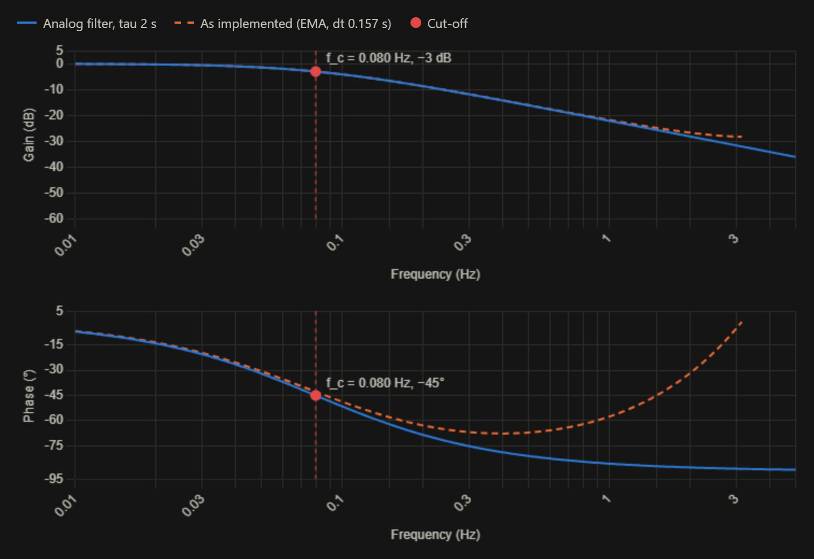

The cut-off is at f_c = 0.080 Hz, where the gain is −3 dB and the phase is −45°.

I used the cut-off formula f_c = 1/(2π·τ) with τ = 2 s, giving 1/(2π·2) = 0.0796 Hz. The analog (blue) curves use H(f) = 1/(1 + j·2πfτ), so gain = −10·log10(1 + (2πfτ)²) dB and phase = −arctan(2πfτ).

The dashed orange curve is the filter as coded, `y += α(x − y)` with α = 1 − exp(−dt/τ) at your 0.157 s tick. It matches the analog one up to about 1 Hz and drops a little faster near the 3.2 Hz Nyquist limit.

Above f_c the gain falls by 20 dB per decade. That is −11.8 dB at 0.3 Hz and −22 dB (a factor of 12.6) at 1 Hz, where most of your noise is. A step settles to about 95% after 3τ, or 6 s.

#### Literatur
- [Jason Sachs, low pass filter](https://www.dsprelated.com/showarticle/779/ten-little-algorithms-part-2-the-single-pole-low-pass-filter)
- [Steven Smith, DSP](https://dspguide.com/ch19/2.htm)

- [Geoffrey Hunter, EMA Filters](https://blog.mbedded.ninja/programming/signal-processing/digital-filters/exponential-moving-average-ema-filter/)