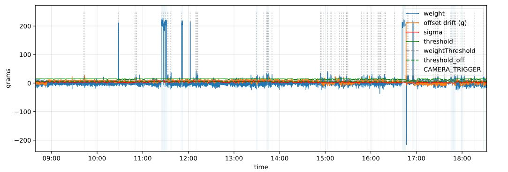
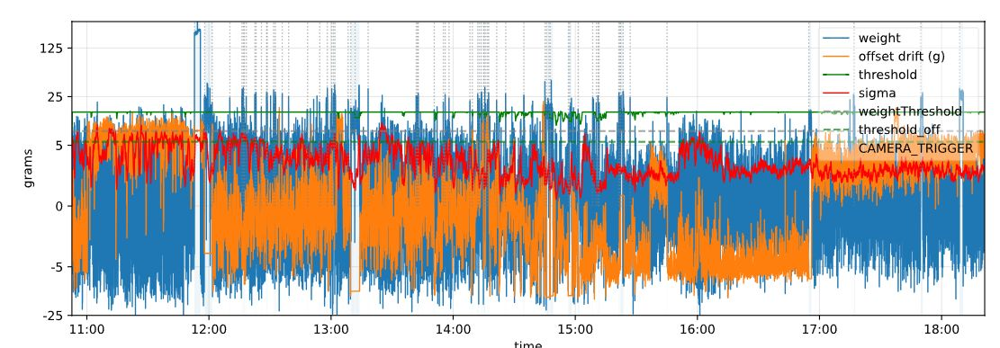
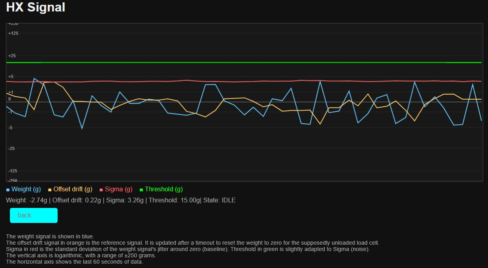

<!--keywords[Drift,Offset,Polarität,Sigma,Spread,Waage]-->

- Der Sitzbalken am Vogelhaus ist eine Waage, die die Kameraaufzeichnung auslöst. Die Sitzstange sitzt auf einem Aluminiumbalken, der sich bei Last leicht verbiegt, was durch vier Widerstände von 1 kOhm gemessen wird, die dem Aluminium aufgeklebt und als Wheatstone Bridge verschaltet sind. 
- Die analoge Widerstandsänderung der Wheatstone Bridge wird durch die hx711 Platine in Digitalwerte - sog. **ADC (analog digital count)** übersetzt, die dann von dem C-Treiber `station3/c/libhx711.so` ausgelesen werden, der wiederum in das Pythonscript `hxFiBirdStateCt.py` oder `calibrateHxC.py` eingebunden ist. Beide Pythonskripte werden durch Bashskripte `hxFiBird.sh bzw. calibrateScale.sh` als Wrapper gestartet, das `hxFiBird.sh` wiederum beim Booten durch `hxFiBird.service` (systemd Service).
- `station3/calibrateScale.sh` wird nach `SSH Login` auf der Kommandozeile ausgeführt. Es schreibt vier Kennzahlen nach `config.json`: `polarity, hxOffset, hxScale, spread`.
- *polarity*: Geht der ADC bei Belastung der Sitzwaage ins positive (+1) oder ins negative (-1), je nachdem wie der Wägebalken eingebaut und angeschlossen wurde.
- *hxOffset*: Welcher ADC entspricht der unbelasteten Waage (Null-Tarierung)
- *hxScale*: Wieviele ADC entsprechen einem Gramm.
- *spread*: Wieviele ADC schwankt die unbelastete Waage.

Ein einfaches Zahlenbeispiel: Die Waage liefert unbelastet 100tausend Counts (ADC). Das `hxOffset` ist also `100 000`. Die Waage wird beim Kalibrieren mit 100 Gramm belastet und geht auf `200 000`. Daraus ist ersichtlich, dass die Waage positiv gepolt ist (+1) und 1 Gramm `1000 Counts` entspricht, also`hxScale = 1000`. Wäre die Waage negativ gepolt, wäre das ADC durch 100 Gramm auf Null gegangen, bei mehr Gewicht ins Negative. Der Widerstandswert der Waage zeigt aber eine ständige labile Schwankung, z.B. während des Kalibrierens unbelastet `97 000 bis 103 000`, also ein Spread von `6 000 counts`, was dann 6 Gramm entspricht.

- Dieser Spread, auch als *Grundrauschen* oder *Noise* der Waage bezeichnet, ist das eigentlich problematische und kann die labile Elektronik der Waage kurzfristig und andauernd besonders bei feuchtwindigen Aussenverhältnissen so schwanken lassen als wäre ein Vogel von z.B. 8 Gramm anwesend. Das führt dann zu Fehlauslösern mit falsch positiven Leervideos, wenn nicht der zeitliche Gewichtsablauf oder die Kameraauswertung über eine vogelerkennende lokale KI zugezogen werden.

- Dieser Noise ist als Gauss Glockenkurve darstellbar, also bei weniger Schwankung eine schmale Glocke, bei mehr Schwankung eine breitere. Die Breite der Glocke wird üblicher Weise durch **Sigma** ausgedrückt, das ist die **halbe** Glockenbreite auf ca. 2/3 ihrer Höhe. 3 * Sigma entsprechen ca. 99% der Glockenbreite. Der obige Spread von `6000 counts` entspricht dann einem Sigma von ca. `1000 (6000/3/2)` oder 1 Gramm .

- Mit steigendem Sigma ist eine automatische Erhöhung der Triggerschwelle sinnvoll. Ab etwa 6 Gramm Sigma können leichtere Vögel (unter 15 Gramm) durch die Waage allein nicht mehr zuverlässig erkannt werden.

In der linearen Darstellung sieht es noch harmlos aus, besonders wenn gelegentlich eine Taube von ca. 200 Gramm das Basalrauschen klein erscheinen lässt.

 

Aber bei einer halblogarithmischen Y-Gewichtsachse, die den unteren Gewichtsbereich betont, wird der geringe Abstand zur Triggerschwelle (grün) schon sehr auffällig (`SignalLogger aus hxFiBirdStateCt.py`).

Blau ist die Gewichtsschwankung, Orange ist das hxOffset, das softwareseitig ständig nachgeregelt wird, um das unbelastete Gewicht bei Null zu halten, und Rot ist der Sigmawert, der hier schon grenzwertig ist. Dadurch hat die Software die Triggerschwelle von 8 Gramm auf ein Maximum von 15 Gramm erhöht (grüne Linie).

Auf eine Minute gespreizt, sieht das halblogarithmisch etwa so aus (`LiveLogger aus hxFiBirdStateCt.py`):

