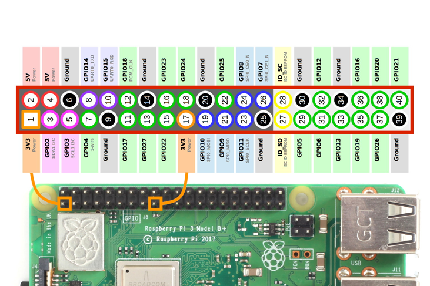
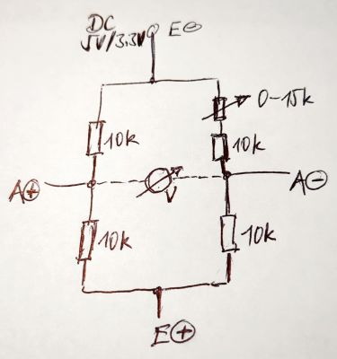
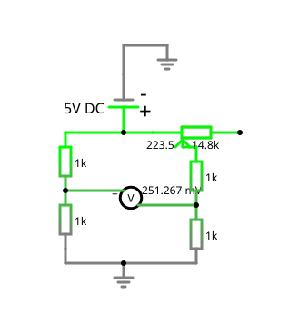
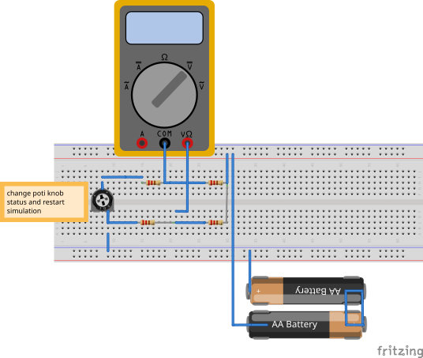

<!--keywords[ADC,Falstad,Fritzing,Dehnmesstreifen,Hx711,load_cell,Verdrahtung,wiring,Wheatstone]-->

Mit [Falstad](https://www.falstad.com/circuit/) kann man folgende Schaltung für den [Dehnmesstreifen](https://circuitjournal.com/four-wire-load-cell-with-HX711) (strain gauge, load cell) imitieren und den hx711 mit einem Potentiometer testen. Die Simulation zeigt, dass bei 5V DC, selbst wenn die Widerstände der wheatstone Widerstandsanordnung nur 100 Ohm betrügen, nur eine Spannung von 2.5 V für den Raspi Messeingang resultiert.

A+ mit A- kurzschließen (E+, E- frei) ist ein Standardtest für Null Input zur Hx711-Platine, die dann als digitalen Output nur ein bischen *noise* um die Null herum anzeigen sollte und andernfalls Probleme hätte mit Verdrahtung, Minus-Erdung usw.

Wenn VCC des hx711 mit 5V versorgt wird ohne zusätzlichen 3.3V VDD der Platine, müsste sein Data-Signal den 3.3V Pin des Raspi mit der Zeit aufarbeiten, so dass er nicht mehr antwortet (also Verbindung zu GND oder 3.3V nicht mehr differenziert). Ein Spannungsteiler wäre vor dem Raspi Pin angebracht (2 : 1 kOhm) oder Schalttransistor oder *logic level converter*.

```Python Testprogramm
from gpiozero import DigitalInputDevice
import time

# Set the BCM pin number you want to test (e.g., GPIO 17 / physical pin 11)
PIN_TO_TEST = 17

# Initialize as a digital input with an internal pull-down resistor
# This keeps the pin safely at LOW (0) when disconnected.
pin = DigitalInputDevice(PIN_TO_TEST, pull_up=False)

print(f"--- Testing GPIO {PIN_TO_TEST} ---")
print("1. Leave disconnected -> Should read 0 (LOW)")
print("2. Jumper to 3.3V (Pin 1) -> Should read 1 (HIGH)")
print("3. Jumper to GND (Pin 9)  -> Should read 0 (LOW)")
print("Press Ctrl+C to exit.\n")

try:
    while True:
        state = pin.value  # Returns 0 or 1
        print(f"Current State: {state}", end="\r")
        time.sleep(0.1)
except KeyboardInterrupt:
    print("\nTest completed.")
```


Dasselbe Problem müsste auch der DHT22 haben, der ebenso mit 5V versorgt wird.

| 711out                                                       | RPin | Reihe/Spalte | GPIO | Fun  |
| :--- | :--: | :--: | :--: | :--: |
| (VDD)                                                        | 1    | r2s1 |      | 3.3V |
| VCC                                                          | 2    | r2s1 -> 3.3V, falls kein VDD, sonst r1s1 -> 5V |      | 3.3 bzw. 5 V |
| DAT                                                          | 11 | r2s6 | 17 |      |
| CLK                                                          | 16 | r1s8 | 23 |      |
| GND                                                          | 6    | r1s3 |||

| hx711 Board | Load cell |
| :--- | :-------- |
| E+          | red          |
| E-          | black          |
| A-          | green          |
| A+		|	white		|

| DHT22 | Reihe/Spalte |                 |
| :---- | :--------: | :-------------- |
| DAT   | r1s -3       | GPIO 16 /Pin 36 |
| GND   | r1s -4       | Pin 34          |
| VCC   | r2s9 (3.3V) | Pin 17, nicht empfohlen: Pin 4 (5V, r1s2) |


  